.. _um:

User manual
===========

LwBTN is simple button manager library, with great focus on embedded systems.
Motivation behind start of development was linked to several on-going projects including some input reading (button handling),
each of them demanding little differences in process.

LwBTN is therefore relatively simple and lightweight, yet it can provide comprehensive processing of your application buttons.

How it works
^^^^^^^^^^^^

User shall define buttons array and pass it to the library. Next to that, ``2`` more functions are required at application level:

* Function to read the architecture button state
* Function to receive various button events from the library to the application

User shall periodically call processing function with current system time as simple parameter and get ready to receive various events.

A simple example for win32 is below:

.. literalinclude:: ../../examples/example_win32.c
    :language: c
    :linenos:
    :caption: Win32 example code

Input pin state reading
^^^^^^^^^^^^^^^^^^^^^^^

User must implement a callback function that is periodically called from the **LwBTN** library, every time user calls one of the processing functions, such as :c:func:`lwbtn_process` or :c:func:`lwbtn_process_ex` functions.

The input reading function is required to provide the actual state of the input and must return a state:

* ``1`` when input is considered active (pressed)
* ``0`` when input is considered released (not-pressed) or in idle state

.. tip::
    This is the place where you check peripheral GPIO registers in your embedded device and report the status to the library.
    Depending on the physical wiring, you should check if peripheral bit is set or clear, to determine if input is active or inactive.

Input events
^^^^^^^^^^^^

During the button (or input) lifetime, application shall anticipate to receive some of the below listed events (but not limited to, new may be added in the future):

* :c:enum:`LWBTN_EVT_ONPRESS` event is sent to application whenever input goes from inactive to active state and minimum debounce time passes by
* :c:enum:`LWBTN_EVT_ONRELEASE` event is sent to application whenever input sent **onpress** event prior to that and when input goes from active to inactive state
* :c:enum:`LWBTN_EVT_KEEPALIVE` event is periodically sent between **onpress** and **onrelease** events
* :c:enum:`LWBTN_EVT_ONCLICK` event is sent after **onrelease** and only if active button state was within allowed window for valid click event.

On-Press event
^^^^^^^^^^^^^^

Onpress event is the first in a row when input is detected active.
With the nature of embedded systems and various buttons connected to devices, it is necessary to filter out potential noise to ignore unintential multiple presses.
This is done by checking line to be at the stable level for at least some minimum time, normally called *debounce time*. Usually it takes around ``20ms``.
See the :c:macro:`LWBTN_CFG_TIME_DEBOUNCE_PRESS` configuration option to set debounce time.

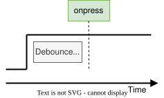

    On-Press event trigger after minimum debounce time

On-Release event
^^^^^^^^^^^^^^^^

Onrelease event is triggered immediately when input goes from active to inactive state, and only if onpress event has been detected prior to that.

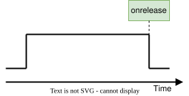

    On-Release event trigger

Optionally, user can also enable debounce for release event.
In this case, **onrelease** is triggered after line is in steady inactive mode for at least minimum defined time.
See :c:macro:`LWBTN_CFG_TIME_DEBOUNCE_RELEASE` configuration option to set debounce time.

On-Click event
^^^^^^^^^^^^^^

Onclick event is triggered after a combination of multiple events:

- **Onpress** event shall be detected properly, indicating button has been pressed
- **Onrelease** event shall be detected, indicating button has been released
- Time between **onpress** and **onrelease** events has to be within time window

When conditions are met, **onclick** event is sent, either immediately after **onrelease** or after certain timeout after **onrelease** event.

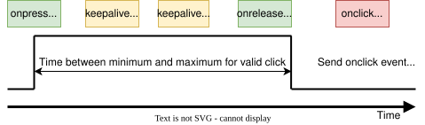

    Sequence for valid click event

A windows-test program demonstration of events is visible below. 

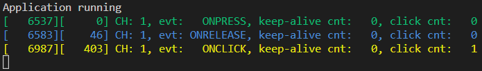

    Click event test program

Second number for each line is a **milliseconds** difference between events.
OnClick is reported approximately (windows real-time issue) ``400`` ms after on-release event.

.. tip::
    Timeout window between last **onrelease** event and **onclick** event is configurable

Multi-click events
^^^^^^^^^^^^^^^^^^

Multi-click feature is where **timeout** for **onclick** event comes into play.
Idea behind timeout feature is to allow multiple presses and to only send **onclick** once for all presses,
including the number of detected presses during that time. This let's the application to react only
once with known number of presses.
This eliminates the problem where in case of **double** click trigger, you also receive **single-click** event,
while you do not know yet, if second (or third) event will be triggered after.

.. note::
    Imagine having a button that toggles one light on single click and turns off all lights in a room on double click.
    With timeout feature and single **onclick** notification, user will only receive the **onclick** once and will,
    based on the consecutive presses number value, perform appropriate action if it was single or multi click.

Simplified diagram for multi-click, ignoring debounce time indicators, is below.
**cp** indicates number of detected **consecutive onclick press** events, to be reported in the final **onclick** event

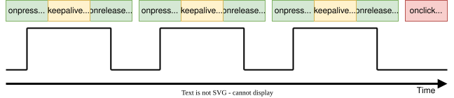

    Multi-click event example - with 3 consecutive presses

A windows-test program demonstration of events is visible below. 

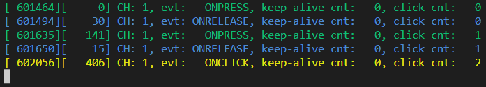

    Multi-click event test program

Multi-click event with **onclick** event reported only after second press after minimum timeout of ``400ms``.

.. note::
    Number of consecutive clicks can be upper-limited to the desired value.

When user makes more (or equal) consecutive clicks than maximum, an **onclick** event is sent immediately after **onrelease** event for last detected click.

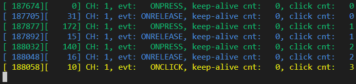

    Max number of onclick events, onclick is sent immediately after onrelease

There is no need to wait timeout expiration since upper clicks limit has been reached. 

.. tip::
    It is possible to control the behavior of **onclick** event (when consecutive number reaches maximum set value) timing using :c:macro:`LWBTN_CFG_CLICK_MAX_CONSECUTIVE_SEND_IMMEDIATELY` configuration.
    When enabled, behavior is as illustrated above. When disabled, **onclick** event it sent in timeout (or in case of new onpress), even if max allowed clicks has been reached.

Illustration below shows what happens during multiple clicks

* Max number of consecutive clicks is ``3``
* User makes ``4`` consecutive clicks

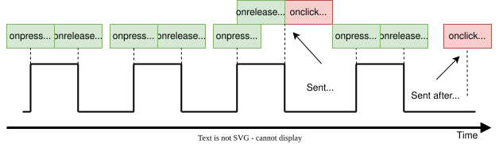

    Multi-click events with too many clicks - consecutive send immediately is enabled - it is sent after 3rd onrelease

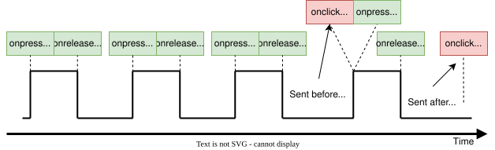

    Multi-click events with too many clicks - consecutive send immediately is disabled

Image below illustrates when send immediately is enabled. It is visible how first **onclick** is sent
just after **onrelease** event (when max consecutive is set to ``3``).

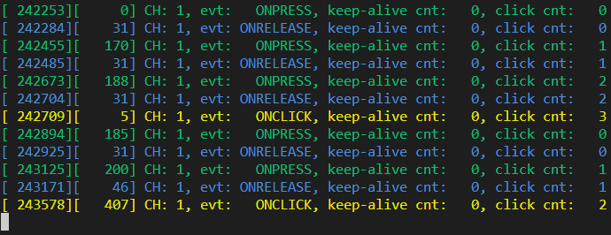

    5 presses detected with 3 set as maximum. First on-click is sent immediately, while second is sent after timeout

When **multi-click** feature is disabled, **onclick** event is sent after every valid sequence of **onpress** and **onrelease** events.

.. tip::
    If you do not want multi-click feature, set max number of consecutive clicks to ``1``. This will eliminate timeout feature since
    every click event will trigger **maximum clicks detected** and therefore send the event immediately after **onrelease**

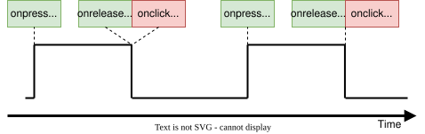

    Multi-click events disabled with cp == 1

Demo log text, with fast pressing of button, and events reported after every **onrelease**

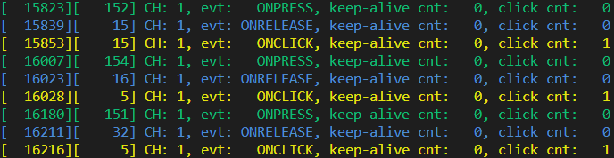

    Multi-click events disabled with cp == 1

Multi-click special case
^^^^^^^^^^^^^^^^^^^^^^^^

There is currently a special case in the library when dealing with multiclicks.
Configuration option :c:macro:`LWBTN_CFG_TIME_CLICK_MULTI_MAX` defines the maximum time between ``2`` consecutive clicks (consecutive **onrelease** events).
Timing starts with **previous** valid click. If next click event starts (that starts with **onpress** event) earlier than maximum time but ends later than maximum, then
new click is not counted as *consecutive* click to previous one.

As such, library will throw ``2`` **click** events to the user.
First one immediately on second **onrelease** event (to take care of first **onpress** and **onrelease** event group) and second one after defined user timeout.

.. note::
    Colors on picture below indicate events that relate to each other, indicated as **green** or **blue** rectangles

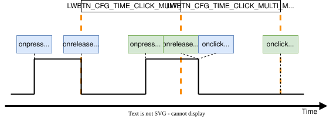

    Special case for multi click when timing overlaps. Orange vertical lines indicate period for valid consecutive clicks.

Keep alive event
^^^^^^^^^^^^^^^^

**Keep-alive** event is sent periodically between **onpress** and **onrelease** events.
It can be used to detect application is still alive and provides counter how many keep-alive events have been sent up to the point of event.

Feature can be used to make a trigger at specific time if button is in active state (a hold event).

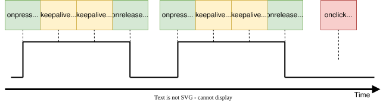

    Keep alive events with 2 successful click events

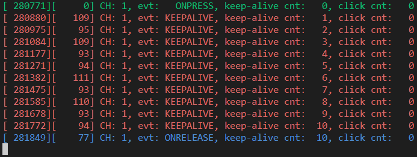

    Keep alive events when button is kept pressed

Keep-alive events are never skipped. If processing is delayed (for example, :c:func:`lwbtn_process` is called later than one keep-alive period),
all missed keep-alive events are sent in the same process call, one by one, and the counter returned by :c:func:`lwbtn_keepalive_get_count`
increases by exactly ``1`` for each event.

This makes keep-alive the right tool to **execute an action exactly once** after the button is held for a specific time.
Compare the keep-alive counter with ``==`` to the number of keep-alive periods for the required time:

.. code-block:: c
    :caption: Execute an action exactly once, after button is held for 2 seconds

    /* Must be a multiple of the keep-alive period */
    #define LONG_PRESS_TIME 2000

    static void
    prv_btn_event(struct lwbtn* lw, struct lwbtn_btn* btn, lwbtn_evt_t evt) {
        if (evt == LWBTN_EVT_KEEPALIVE
            && lwbtn_keepalive_get_count(btn) == lwbtn_keepalive_get_count_for_time(btn, LONG_PRESS_TIME)) {
            /* Executed exactly once per press, even if processing was delayed */
            long_press_action();
        }
    }

Several stages are handled the same way, with one ``==`` check for each stage:

.. code-block:: c
    :caption: Multiple stages during a single hold

    if (evt == LWBTN_EVT_KEEPALIVE) {
        uint16_t cnt = lwbtn_keepalive_get_count(btn);

        if (cnt == lwbtn_keepalive_get_count_for_time(btn, 1000)) {
            led_blink_slow();   /* User feedback: keep holding */
        } else if (cnt == lwbtn_keepalive_get_count_for_time(btn, 5000)) {
            factory_reset();    /* Executed once, after 5 seconds */
        }
    }

.. note::
    :c:macro:`lwbtn_keepalive_get_count_for_time` divides the time by the keep-alive period and rounds the result down.
    Use times that are multiples of the keep-alive period, otherwise the action is executed up to one period earlier.

.. warning::
    Do not use the pressed time functions (see :ref:`um_pressed_time`) to execute an action exactly once.
    Pressed time grows in steps of the processing period and is checked with ``>=``,
    so :c:func:`lwbtn_is_btn_pressed_for` returns ``1`` for every keep-alive event after the time has passed.
    Comparing a pressed time with ``==`` may never be true, as a specific millisecond value can be skipped.

.. _um_pressed_time:

Pressed time
^^^^^^^^^^^^

Library tracks how long each button has been continuously pressed. ``2`` functions are available:

* :c:func:`lwbtn_is_btn_pressed_for` returns ``1`` if button has been pressed for at least ``min_time`` milliseconds
* :c:func:`lwbtn_is_btn_pressed_for_range` returns ``1`` if button has been pressed for a time between ``min_time`` and ``max_time`` milliseconds.
  Both bounds are inclusive, and function returns ``0`` if ``min_time`` is greater than ``max_time``

Pressed time is measured from the **onpress** event (after the press debounce) until the last process call for this button.

* Within any event callback, last process call is the current one, so pressed time is exact
* Outside the callbacks, pressed time is as old as the last process call
* Both functions return ``0`` when button is not pressed, or after :c:func:`lwbtn_reset` has been called
* Within the **onrelease** event callback, both functions check how long the button was pressed before it was released (see below)

.. tip::
    Pressed time functions answer *"has the button been pressed for this time"* and stay true while the button is held.
    To execute an action *exactly once*, use the keep-alive counter instead, as described in the keep-alive section above.

Pressed for minimum time
************************

:c:func:`lwbtn_is_btn_pressed_for` can be used anywhere in the application, not only within the event callbacks.
It is a state check, that stays true as long as the button is held:

.. code-block:: c
    :caption: Turn on the warning LED while the button is held for at least 3 seconds

    while (1) {
        lwbtn_process(get_tick());
        led_set(LED_WARNING, lwbtn_is_btn_pressed_for(&btns[0], 3000));
    }

Pressed time on release
***********************

Within the **onrelease** event callback, button is no longer active (:c:func:`lwbtn_is_btn_active` returns ``0``),
but pressed time functions and :c:func:`lwbtn_keepalive_get_count` still report the state just before the release.
This allows the application to take different actions, depending on how long the button was pressed:

.. code-block:: c
    :caption: Different actions on release, depending on the pressed time

    if (evt == LWBTN_EVT_ONRELEASE) {
        if (lwbtn_is_btn_pressed_for(btn, 5000)) {
            very_long_press_action();       /* Pressed for 5 seconds or more */
        } else if (lwbtn_is_btn_pressed_for_range(btn, 2000, 4999)) {
            long_press_action();            /* Pressed for 2 to 5 seconds */
        }
    }

.. note::
    Pressed time on release is the time between the **onpress** and the **onrelease** events.
    When release debounce is enabled (see :c:macro:`LWBTN_CFG_TIME_DEBOUNCE_RELEASE`), it includes the release debounce time.

After the **onrelease** callback returns, both functions return ``0``.

Buttons pressed together
************************

:c:func:`lwbtn_is_btn_pressed_for_range` can be used to detect ``2`` buttons pressed together (a button combination).
If both buttons have been pressed for a time between ``COMBO_HOLD_TIME`` and ``COMBO_HOLD_TIME + COMBO_TOLERANCE``,
they are both held long enough, and they were pressed at most ``COMBO_TOLERANCE`` milliseconds apart, in any order:

.. code-block:: c
    :caption: Detect 2 buttons pressed together and held for 1 second

    /* Minimum time both buttons must be held */
    #define COMBO_HOLD_TIME     1000
    /* Max time between both presses, in any order. Must be larger than keep-alive period */
    #define COMBO_TOLERANCE     200

    static void
    prv_btn_event(struct lwbtn* lw, struct lwbtn_btn* btn, lwbtn_evt_t evt) {
        if (evt == LWBTN_EVT_KEEPALIVE
            && lwbtn_is_btn_pressed_for_range(&btns[0], COMBO_HOLD_TIME, COMBO_HOLD_TIME + COMBO_TOLERANCE)
            && lwbtn_is_btn_pressed_for_range(&btns[1], COMBO_HOLD_TIME, COMBO_HOLD_TIME + COMBO_TOLERANCE)) {
            combo_action();

            /* Reset both buttons -> combination is executed once, no further events until buttons are pressed again */
            lwbtn_reset(lw, &btns[0]);
            lwbtn_reset(lw, &btns[1]);
            return;
        }
        /* Handle other events... */
    }

How it works:

* Both range checks are true only when both buttons are held for at least ``COMBO_HOLD_TIME``, and their presses are at most ``COMBO_TOLERANCE`` milliseconds apart
* Check is symmetric and can be done in the keep-alive event of any button
* Resetting both buttons executes the combination only once, and prevents their own **onrelease**, **onclick** and further keep-alive events,
  so the application does not execute single-button actions after the combination

To only check that both buttons are held, regardless of when each one was pressed, use :c:func:`lwbtn_is_btn_pressed_for` instead of the range checks.

.. note::
    Combination is detected only if the check runs while both pressed times are within the range.
    That time window is ``COMBO_TOLERANCE`` minus the time between both presses.
    With the check in keep-alive events, presses that are at most ``COMBO_TOLERANCE`` minus keep-alive period apart are always detected.
    The check can also be done in the main loop, after every :c:func:`lwbtn_process` call, for a finer resolution.

.. note::
    :c:func:`lwbtn_process` processes buttons in the array order.
    Within a button's callback, buttons with higher array index have not been processed yet in this call,
    so their pressed time is from the previous process call.
    Set ``COMBO_TOLERANCE`` larger than the processing period.

.. tip::
    Each button is also processed on its own and sends its own events, before the combination is detected.
    Execute single-button actions on **onrelease** or **onclick** events,
    or with a hold time longer than ``COMBO_HOLD_TIME + COMBO_TOLERANCE``,
    so that the reset cancels them when the combination is detected.

Debounce
^^^^^^^^

Debouncing is a software mechanics to remove unwanted bouncing events introduced by the physical buttons.

.. tip::
    This chapter will not go into details about generic debouncing problem. 
    Have a look at `Wikipedia post about Switches <https://en.wikipedia.org/wiki/Switch>`_.

Library supports ``2`` separate debounce options:

* **Debounce on press event**: This is almost always a must-have in the application, and helps to detect valid "press" event only once after the input is in stable active state for minimum time in a row.
    
    Press event debounce can only be disabled, if application can ensure stable transition from inactive to active state. This is usually done using capacitor and resistor next to the push button (this may not be the most optimized solution for contact longevity)

* **Debounce on release event**: This is usually not necessary by most of the applications,

    but can be used in harsh environments, where unwanted external noise could affect line and put it to inactive state for short period of time (while user holds button *down* in active state).

.. note::
    Configuration settings :c:macro:`LWBTN_CFG_TIME_DEBOUNCE_PRESS` and :c:macro:`LWBTN_CFG_TIME_DEBOUNCE_RELEASE` are used to set the debounce time in milliseconds.
    When one of the values is set to ``0``, debounce feature for respective transition is not actived.

.. tip::
    Debounce time of around ``20ms`` is usually a good tradeoff between application reactivity to user events and debounce time required to stabilize the input.

Debounce examples
*****************

Examples are demonstrated using `NUCLEO-L011K4 <https://www.st.com/en/evaluation-tools/nucleo-l011k4.html>`_ board. ``2`` GPIO pins are used, one in input config, second as output.

* **Input pin (Blue)**: A raw input that acts as an user button. There is no hardware filtering. Pin is active when *low* and inactive when *high*.

* **Output pin (Red)**: Output pin is software controlled. It goes *high* on *press* event and it goes *low* on *release* event. *Press* and *release* events are reported by the library.

.. note:: 
    Logic analyzer has been connected directly to the microcontroller pins.

**Examples #1**

* :c:macro:`LWBTN_CFG_TIME_DEBOUNCE_PRESS` = ``20``
* :c:macro:`LWBTN_CFG_TIME_DEBOUNCE_RELEASE` = ``20``

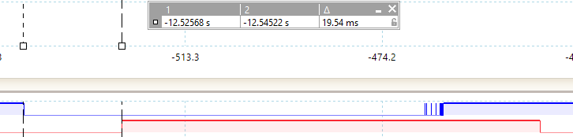

    20ms debounce for press event. Press event is triggered only after input is stable in active state for minimum time.

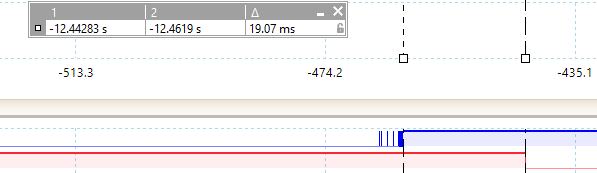

    20ms debounce for release event. Release event is triggered only after input is stable in inactive state for minimum time.

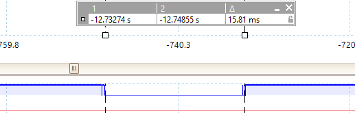

    20ms debounce for press event - press event was not triggered - input was in stable active state for less than minimum debounce time (red line stays low).

**Examples #2**

* :c:macro:`LWBTN_CFG_TIME_DEBOUNCE_PRESS` = ``20``
* :c:macro:`LWBTN_CFG_TIME_DEBOUNCE_RELEASE` = ``0`` - release debounce is disabled

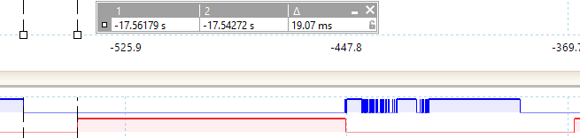

    Press event is detected after initial debounce, while release event is detected immediately on button going to inactive state.

**Examples #3**

* :c:macro:`LWBTN_CFG_TIME_DEBOUNCE_PRESS` = ``100``
* :c:macro:`LWBTN_CFG_TIME_DEBOUNCE_RELEASE` = ``100``

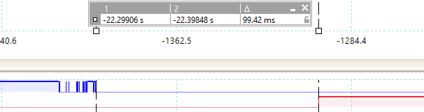

    100ms debounce for press event. Input bouncing is clearly visible on the diagram. Press event is triggered only after input is stable in active state for minimum time.

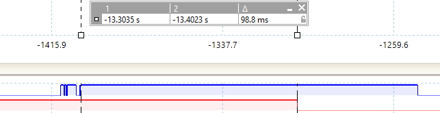

    100ms debounce for release event. Release event is triggered after input is in stable inactive state for at least release debounce time.

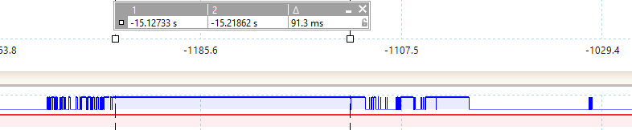

    Input is in *pressed* state (red is high). Blue is in released state for less that minimum stable debounce time, therefore no *release* event has been triggered.
    This is clearly visible with the *red* line that is staying high for the whole time of the transient period.
